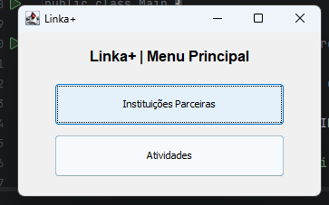
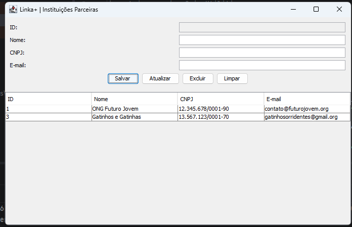
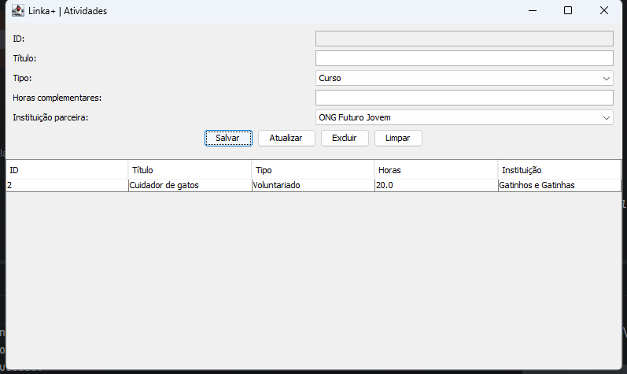

# Linka+ | CRUD de Instituições Parceiras e Atividades

Aplicação desktop em Java desenvolvida para a disciplina de Programação Orientada a Objetos, usando como base a startup **Linka+**, uma plataforma educacional que conecta estudantes a cursos, palestras, voluntariados e vagas de estágio oferecidos por instituições parceiras, ajudando também no controle de horas complementares.

O sistema permite cadastrar, listar, atualizar e excluir **Instituições Parceiras** e as **Atividades** que cada uma oferece.

## Screenshots






## Integrantes

| Nome completo
| Glaziane Amaral Bewzenko 


## Tecnologias e bibliotecas

- Java (JDK 21 ou superior)
- Java Swing (interface gráfica)
- JDBC (acesso ao banco de dados)
- MySQL 8 e MySQL Workbench
- MySQL Connector/J 9.1.0 (`com.mysql:mysql-connector-j:9.1.0`)
- IntelliJ IDEA

## Estrutura do projeto (MVC + DAO)

```
src/
├── Model/        → entidades do domínio (InstituicaoParceira, Atividade)
├── DAO/          → acesso ao banco com SQL (InstituicaoParceiraDAO, AtividadeDAO)
├── Util/         → ConnectionFactory (conexão com o MySQL)
├── Controller/   → regras de negócio e ligação entre View e DAO
├── View/         → telas em Swing (menu, instituições, atividades)
└── Main.java     → ponto de entrada da aplicação
```

- **Model:** classes de domínio e DAOs. Uma `InstituicaoParceira` oferece várias `Atividade`s (relação 1:N), e cada `Atividade` guarda o objeto da instituição que a oferece.
- **DAO:** concentra toda a parte de SQL (INSERT, SELECT com INNER JOIN, UPDATE e DELETE) usando `PreparedStatement`.
- **Controller:** recebe as ações dos botões, valida os dados (campos obrigatórios, CNPJ com 14 dígitos, horas maiores que zero) e chama os DAOs.
- **View:** janelas com formulário, botões e tabela (`JTable`).

## Banco de dados

Duas tabelas relacionadas:

- `instituicao_parceira` (id, nome, cnpj, email)
- `atividade` (id, titulo, tipo, horas_complementares, id_instituicao → chave estrangeira para `instituicao_parceira`)

O script completo está no arquivo [`banco.sql`](banco.sql).

## Como instalar e executar

1. Instale o **JDK 21+**, o **MySQL 8** (com o Workbench) e o **IntelliJ IDEA**.
2. Clone o repositório:
   ```
   git clone https://github.com/Glazi09/CrudStartup_ProjetoFinal.git
   ```
3. Abra o MySQL Workbench, abra o arquivo `banco.sql` e execute (ícone do raio) para criar o banco `linka_startup` e as tabelas.
4. Abra a pasta do projeto no IntelliJ (**File > Open**).
5. Adicione o driver do MySQL: **File > Project Structure > Libraries > + > From Maven...**, pesquise `com.mysql:mysql-connector-j:9.1.0` e confirme.
7. Execute a classe `Main.java`. O menu principal vai abrir com as opções **Instituições Parceiras** e **Atividades**.

## Como usar

- **Criar:** preencha o formulário e clique em **Salvar**.
- **Ler:** os registros aparecem automaticamente na tabela.
- **Atualizar:** clique numa linha da tabela, altere os dados no formulário e clique em **Atualizar**.
- **Excluir:** selecione uma linha e clique em **Excluir**.
- Para cadastrar uma atividade, é preciso ter pelo menos uma instituição cadastrada. Uma instituição que ainda tem atividades não pode ser excluída (restrição da chave estrangeira).

## Transparência de IA


O projeto foi desenvolvido com base nos códigos apresentados pelo professor em aula (projeto da Clínica Veterinária), seguindo o mesmo padrão de organização em MVC e DAO. Utilizei o Claude (Anthropic) como apoio: fui escrevendo as classes e pedindo para a IA revisar e corrigir os erros, e montei as telas e os Controllers de acordo com o modelo do professor, usando a IA para ajudar a escrever e corrigir o código. Também usei a IA para entender partes do código que eu não compreendia. Todas as funcionalidades foram testadas e revisadas para garantir o entendimento do código.